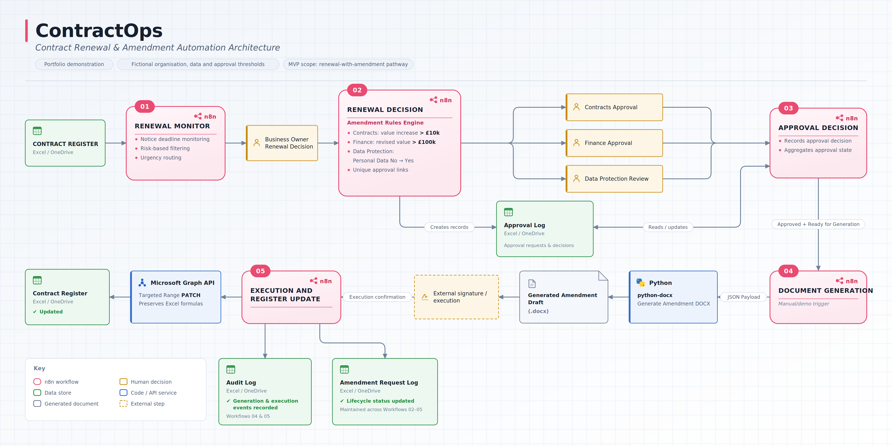

# ContractOps

**Contract renewal and amendment automation prototype**

ContractOps is a fictional contract-operations MVP built with **n8n, Microsoft Excel / OneDrive, Microsoft Graph and Python**. It demonstrates a renew-with-amendments pathway from renewal monitoring through approval routing, document generation, execution and structured audit logging.

> **Portfolio demonstration only.** Aurelia Technologies Ltd, all contract data, people, email addresses and approval thresholds in this repository are fictional. The project is not legal advice and is not presented as a production-ready contract-management system.

**[▶ Watch the ContractOps demo](https://youtu.be/s1qhXixQNKk)**



## What the prototype demonstrates

- **Renewal monitoring** using calculated notice deadlines and risk tiers in an Excel contract register.
- **Urgency routing** for overdue, urgent and upcoming renewal decisions.
- **Business-owner decision capture** through n8n forms.
- **Rules-based amendment approvals** for Contracts, Finance and Data Protection review.
- **Unique approval links** tied to individual approval-request IDs.
- **Approval-state aggregation** so document generation remains blocked until all required approvals are complete.
- **Automated Word generation** using Python and `python-docx`.
- **Execution confirmation** followed by controlled updates to the live contract register.
- **Formula preservation** using a targeted Microsoft Graph range PATCH rather than rewriting the full Excel row.
- **Audit logging** for document generation and amendment execution.

## MVP scope

The implemented end-to-end pathway is **Renew with amendments**.

The renewal-decision workflow also contains routes for **Renew unchanged**, **Do not renew** and **Terminate early**, but those routes are intentionally left as future extension points in this MVP.

Email delivery, e-signature and authentication / role-based access are also outside the current demonstration scope. Approval links are generated by the workflow, while signing is represented as an external step before execution is recorded.

## Workflow overview

| Workflow | Purpose |
| --- | --- |
| `01-renewal-monitor.json` | Reads the contract register, identifies active contracts requiring a renewal decision and routes them as overdue, urgent or upcoming. |
| `02-renewal-decision.json` | Captures the Business Owner's decision, collects proposed amendment terms, evaluates fictional approval rules and creates parent / child approval records. |
| `03-approval-decision.json` | Records individual approval decisions, re-reads sibling approvals, aggregates the overall approval state and unlocks document generation only when all required approvals are approved. |
| `04-document-generation.json` | Finds approved amendments ready for drafting, prepares a JSON payload and invokes the Python generator to create a `.docx` amendment. |
| `05-amendment-execution.json` | Records execution, applies approved values to the contract register using Microsoft Graph, marks the amendment executed and writes the final audit entry. |

## Demonstration approval rules

The rules below are **fictional portfolio rules**, not organisational policy:

- **Contracts approval:** amendment value increase is greater than **£10,000**.
- **Finance approval:** revised total contract value is greater than **£100,000**.
- **Data Protection review:** personal-data processing changes from **No → Yes**.

The contract-register risk tier is also calculated using fictional thresholds:

- **High:** current contract value ≥ £100,000 **or** Critical Service = Yes.
- **Medium:** current contract value ≥ £25,000 **or** Personal Data = Yes **or** Supplier Access to Internal Systems = Yes.
- **Low:** otherwise.

## Technical design notes

### 1. Excel remains the operational data store

The demo workbook contains structured tables for the Contract Register, People directory, Amendment Request Log, Approval Log and Audit Log. Calculated columns in the Contract Register derive:

- Notice Deadline
- Days to Notice Deadline
- Risk Tier

### 2. Approval requests are separate child records

Each required review receives its own Approval Request ID, for example:

```text
AMD-CTR-006-YYYYMMDDHHMMSS-CONTRACTS
AMD-CTR-006-YYYYMMDDHHMMSS-FINANCE
AMD-CTR-006-YYYYMMDDHHMMSS-PRIVACY
```

Workflow 03 aggregates those sibling records into a single parent amendment state:

```text
Any rejected  -> Rejected / Blocked
Any pending   -> Pending / Not Ready
All approved  -> Approved / Ready for Generation
```

### 3. Document generation is separated from execution

Approval does **not** immediately alter the operative contract register. Workflow 04 first creates an amendment draft. The register is updated only after the amendment has been fully executed and Workflow 05 records that execution.

### 4. Microsoft Graph preserves Excel formulas

During development, the standard Excel row-update operation replaced calculated-column formulas with static values. Workflow 05 therefore uses a targeted Microsoft Graph range PATCH and writes only the source fields that actually change.

This preserves the workbook's calculated Notice Deadline, Days to Notice Deadline and Risk Tier formulas.

## Repository structure

```text
ContractOps/
├── README.md
├── requirements.txt
├── workflows/
│   ├── 01-renewal-monitor.json
│   ├── 02-renewal-decision.json
│   ├── 03-approval-decision.json
│   ├── 04-document-generation.json
│   └── 05-amendment-execution.json
├── scripts/
│   └── generate_amendment.py
├── diagrams/
│   └── contractops-architecture.png
├── sample/
│   ├── ContractOps_Demo.xlsx
│   └── CTR-006_Amendment_001.docx
└── generated_documents/
```

## Sample scenario

The included sample amendment demonstrates an amendment to fictional contract **CTR-006** for **PeopleWorks Consulting Ltd**.

The scenario increases the contract value from **£32,000 to £110,000**, extends the expiry date and introduces personal-data processing. Those changes trigger all three fictional approval routes: Contracts, Finance and Data Protection.

Once the approvals are complete, the document-generation workflow creates `CTR-006_Amendment_001.docx`. Following external execution, Workflow 05 updates the contract record, increments the version and records the event in the audit log.

## Running the project locally

This repository contains **sanitised workflow exports**. Credential references, instance-specific workflow metadata, the original OneDrive workbook item ID, local filesystem paths and production form IDs have deliberately been removed or replaced with placeholders.

To reproduce the demonstration:

1. Upload `sample/ContractOps_Demo.xlsx` to OneDrive.
2. Import the five JSON files from `workflows/` into n8n.
3. Reconnect your own Microsoft OneDrive / Excel OAuth credentials.
4. Replace `REPLACE_WITH_ONEDRIVE_WORKBOOK_ID` in the Excel / OneDrive nodes with the uploaded workbook's item ID.
5. Publish Workflow 03 and replace `REPLACE_WITH_WORKFLOW_03_FORM_ID` in the three approval-link expressions in Workflow 02 with the Workflow 03 production form ID.
6. Install the Python dependency:

   ```bash
   pip install -r requirements.txt
   ```

7. In Workflow 04, update the Execute Command node to the local path of `scripts/generate_amendment.py`. The script writes generated files to `generated_documents/` by default. You can override this with the `CONTRACTOPS_OUTPUT_DIR` environment variable.
8. Configure Workflow 05's Microsoft Graph request for the OneDrive path where you uploaded the workbook. The sanitised export uses the example path `Documents/ContractOps/ContractOps_Demo.xlsx`.
9. Publish the relevant form workflows and run the workflows in lifecycle order.

> Depending on the n8n deployment, the Execute Command node may need to be explicitly enabled. This prototype was developed on a private local n8n instance.

## Key technologies

- **n8n** — workflow orchestration and forms
- **Microsoft Excel / OneDrive** — structured contract and workflow records
- **Microsoft Graph API** — targeted contract-register updates
- **Python / python-docx** — amendment document generation
- **JavaScript expressions / n8n Code nodes** — approval rules, aggregation and transformation logic

## Development notes

A significant part of this project was validating behaviour across system boundaries rather than simply building the happy path. Examples included:

- distinguishing n8n `.item` linking from `.first()` when referencing single trigger context;
- re-reading approval records after updates so aggregation reflects current state;
- identifying and correcting approval-request ID consistency issues;
- separating document generation from legal execution;
- preserving calculated Excel columns during API updates; and
- handling OneDrive / desktop Excel sync behaviour during testing.

These decisions are reflected in the final workflow design rather than hidden from the demonstration.

## Future extensions

Potential next steps include:

- complete the Renew unchanged, Do not renew and Terminate early routes;
- email approval / execution links to assigned users;
- add authenticated approver identity and role validation;
- integrate e-signature status callbacks;
- add duplicate-request protection and exception handling; and
- replace the demonstration workbook with a dedicated database / contract-management platform for production use.
